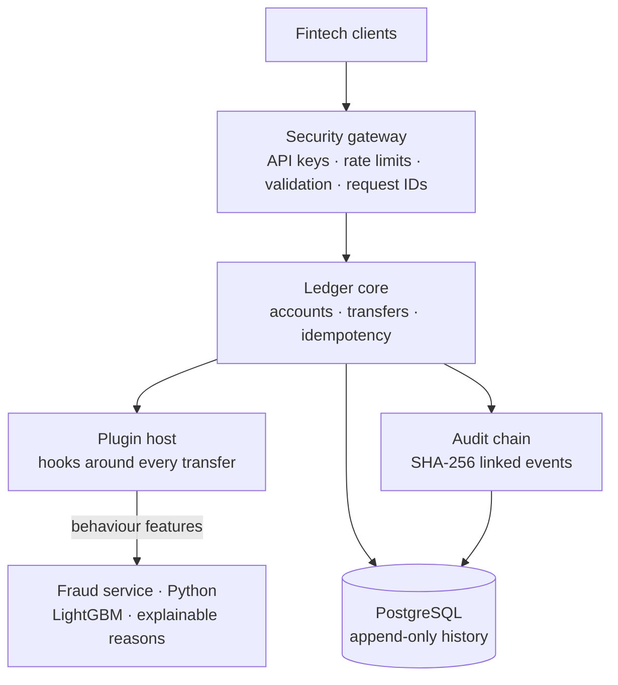

# LedgerForge

[](https://github.com/Moreitu1985/Fintech-sandbox-API-/actions/workflows/ci.yml)
[](https://github.com/Moreitu1985/Fintech-sandbox-API-/actions/workflows/load-test.yml)


[](LICENSE)

**A secure, multi-tenant double-entry ledger API for fintechs: money that can't be lost, duplicated or quietly rewritten.**

Built with Java 21 and Spring Boot 3, backed by PostgreSQL, and tested for the failures that cost real money: double charges on retry, race conditions between concurrent payments, cross-tenant data leaks and tampered records.

> Sandbox platform: LedgerForge moves simulated money with production-grade rules. Real money movement is planned through a licensed partner (see Roadmap).

---

## Why it exists

Every fintech needs a ledger, and most build one from scratch. The hard parts, correctness under concurrency, safe retries and trustworthy audit history, take months and are easy to get subtly wrong. LedgerForge packages those parts as a tested API.

## What it does

| Capability | How |
|---|---|
| Double-entry ledger | Every transfer writes two postings that sum to zero; balances are verifiable against history |
| Safe retries | `Idempotency-Key` header: a retried request returns the original result and never moves money twice |
| Concurrency safety | Row locks taken in a fixed order: no lost updates, no deadlocks, no negative customer balances |
| Multi-tenancy | Each fintech sees only its own data; cross-tenant ids return 404 |
| Tamper-evident audit | Per-tenant SHA-256 hash chain; append-only tables enforced by PostgreSQL triggers |
| Proof on demand | `GET /v1/ledger/integrity` checks that books balance, balances match postings and the audit chain is intact |
| Plugins | `TransferPlugin` beans hook into every transfer without touching the core (examples: per-transfer limit, fraud check) |
| AI ledger assistant | `POST /v1/assistant/ask` answers plain-English questions about your own ledger with Claude, through read-only tools scoped to your tenant ([ADR 0006](docs/adr/0006-ai-assistant-read-only-tools.md)) |
| AI fraud detection | A Python ML service scores each customer transfer before money moves: **BLOCK**, **REVIEW** or **ALLOW**, with plain-language reasons ([model card](fraud-service/MODEL_CARD.md)) |
| Authentication | API keys, or OAuth 2.0 client credentials: 15-minute RS256 access tokens with scopes (`ledger:read`, `ledger:write`, `assistant`) and a public JWKS ([ADR 0008](docs/adr/0008-oauth2-tokens-and-mtls.md)) |
| Service-to-service security | Mutual TLS between the ledger and the fraud service: each side proves its identity with a certificate from a private CA, plus a service token |
| API security | Hashed API keys, constant-time checks, rate limits shared across instances in Redis, strict headers, RFC 9457 errors with request ids |
| Observability | Prometheus metrics (transfers, fraud decisions, assistant tokens, rate limiting, HTTP, DB pool, JVM) behind a read-only metrics token; OpenTelemetry traces of API requests and fraud-service calls ([guide](docs/OBSERVABILITY.md)) |

## Architecture



## Authentication: API keys and OAuth 2.0

API keys work directly (`Authorization: Bearer lf_test_...`). For less exposure, exchange the key for a **15-minute access token** and send that instead:

```bash
curl -s -X POST localhost:8080/oauth/token -u "$KEY_ID:$KEY" \
  -d grant_type=client_credentials -d scope="ledger:read"
# {"access_token":"eyJ...","token_type":"Bearer","expires_in":900,"scope":"ledger:read"}

curl -s localhost:8080/v1/accounts -H "Authorization: Bearer eyJ..."
```

| Scope | Allows |
|---|---|
| `ledger:read` | `GET` on accounts, statements, transfers, integrity |
| `ledger:write` | Opening accounts and making transfers |
| `assistant` | The AI ledger assistant (also needs `ledger:read`, because the assistant reads the ledger for you) |

A token carries only the scopes asked for, so a reporting tool can hold read-only access. Send token-request parameters in the body, never the URL; each client can request 10 tokens a minute, so reuse a token until it nears expiry. Tokens are RS256-signed and typed `at+jwt` (RFC 9068); other services can verify them with the public key at `GET /oauth/jwks.json`. Revoking the API key stops new tokens immediately, and existing ones expire within 15 minutes.

## AI fraud detection (Phase 2)

Before a customer transfer moves money, and before any lock is taken, the `fraud-check` plugin computes behaviour features from the ledger itself (amount vs. the account's usual, transfers in the last hour, first payment to this recipient, share of balance used, account age, time of day) and asks the [fraud service](fraud-service/) for a decision.

| Decision | What happens |
|---|---|
| **BLOCK** | Transfer refused with `422 PLUGIN_REJECTED` (generic message); no money moves; a `FRAUD_BLOCK` event with score and reasons is committed to the audit chain |
| **REVIEW** | Transfer goes ahead; a `FRAUD_REVIEW` event with score and reasons is added to the tamper-evident audit chain |
| **ALLOW** | Nothing extra |

Example reasons recorded for a blocked transfer: *"Transfer uses 97% of the available balance · First transfer to this recipient · Late-night transfer (02:00)"*. They go to the audit log; the API caller only sees "declined by risk checks", so the reasons cannot be used to tune an attack.

Held-out results on synthetic data: at a 1% false-alarm rate the model catches **95.6%** of fraud, against **25.5%** for a hand-written rule at a similar rate. BLOCK decisions are **96.6%** precise. CI retrains the model and fails if quality drops. See the [model card](fraud-service/MODEL_CARD.md) for data, thresholds and limitations.

Turn it on with `FRAUD_ENABLED=true`, `FRAUD_SERVICE_URL` and `FRAUD_SERVICE_TOKEN`. `docker compose up` runs the ledger, fraud service, PostgreSQL and Redis together, with **mutual TLS** between the ledger and the fraud service: a one-shot `certs` service creates a private CA used only for this link, the fraud service accepts only client certificates from that CA, and the ledger accepts only a server certificate from it. Each container can read only its own private key. A certificate failure always refuses the transfer, even with `FRAUD_FAIL_OPEN=true`. If the fraud service is down or times out, `FRAUD_FAIL_OPEN` decides whether transfers continue (logged) or are refused with `503`. A misconfiguration (wrong token, rejected request) always refuses, so it can never silently switch scoring off.

## AI ledger assistant (Phase 2)

Ask questions about your own ledger in plain English:

```bash
curl -s -X POST localhost:8080/v1/assistant/ask -H "Authorization: Bearer $KEY" \
  -H "Content-Type: application/json" \
  -d '{"question":"Which transfers were flagged for review this week, and from which accounts?"}'
```

```json
{
  "answer": "...",
  "toolsUsed": ["fraud_events", "list_accounts"],
  "rounds": 3,
  "complete": true,
  "model": "claude-haiku-5-5",
  "inputTokens": 3120,
  "outputTokens": 140
}
```

Show `answer` as plain text.

Claude answers by calling a small set of **read-only tools** that Java runs for it: `list_accounts`, `account_statement`, `transfer_summary`, `fraud_events` and `ledger_integrity`.

| Risk | Protection |
|---|---|
| Seeing another fintech's data | The tenant comes from your API key, never from the model; foreign account ids look like missing ones (tested) |
| Moving money or changing data | There are no write tools |
| Prompt injection hidden in account names or descriptions | Tool results are wrapped as `{"untrusted_data": ...}`, a manipulated model can still only read the caller's own data, and links and images are stripped from answers so injected URLs can't leak data through a markdown renderer |
| Runaway cost or load | Per question: at most 5 model calls (tools switched off on the last one), 4 tool calls per round, 60,000 characters of tool data, 1,024 output tokens, a 60-second deadline. Per tenant: 10 questions a minute. Per server: 8 questions in flight |
| Accountability | Every question, including ones that fail part-way, goes into the tamper-evident audit chain with its outcome, the tools used and the token counts |
| Truncated or refused answers | Marked `"complete": false`, never passed off as a full answer |

Turn it on with `ASSISTANT_ENABLED=true` and `ANTHROPIC_API_KEY`; choose the model with `ASSISTANT_MODEL` (default `claude-haiku-5-5`). Tests run against a scripted fake of the Claude API, so CI needs no key.

## Public demo

[](https://render.com/deploy?repo=https://github.com/Moreitu1985/Fintech-sandbox-API-)

The `demo` profile runs the full API with an in-memory database (it resets on restart), Swagger UI, and self-serve sign-up, so anyone can try it without an admin token:

```bash
# Get your own isolated sandbox tenant and API key
curl -s -X POST https://<demo-host>/sandbox/signup \
  -H "Content-Type: application/json" -d '{"name":"My Test Fintech"}'
```

Then open `https://<demo-host>/swagger-ui.html`, click **Authorize**, paste the key, and try the endpoints. On the free plan the demo sleeps when idle, so the first request can take about a minute.

## Quickstart (5 minutes)

**Run locally (in-memory H2 database).** Needs only Java 21: the Maven Wrapper downloads Maven on first use.

```bash
export LEDGERFORGE_ADMIN_TOKEN=$(openssl rand -hex 32)
./mvnw spring-boot:run      # Windows: .\mvnw.cmd spring-boot:run
```

**Or with PostgreSQL via Docker:**

```bash
cp .env.example .env    # then set real secrets in .env
docker compose up --build
```

**Make your first transfer:**

```bash
# 1. Create a tenant (returns an API key once — store it)
curl -s -X POST localhost:8080/admin/tenants \
  -H "X-Admin-Token: $LEDGERFORGE_ADMIN_TOKEN" -H "Content-Type: application/json" \
  -d '{"name":"Acme Pay"}'
export KEY=lf_test_...   # from the response

# 2. Open a funding account and a customer account
curl -s -X POST localhost:8080/v1/accounts -H "Authorization: Bearer $KEY" \
  -H "Content-Type: application/json" -d '{"name":"Treasury","currency":"ZAR","allowNegative":true}'
curl -s -X POST localhost:8080/v1/accounts -H "Authorization: Bearer $KEY" \
  -H "Content-Type: application/json" -d '{"name":"Thandi","currency":"ZAR"}'

# 3. Move R100.00 (amounts are in cents). Run it twice: the money moves once.
curl -s -X POST localhost:8080/v1/transfers -H "Authorization: Bearer $KEY" \
  -H "Idempotency-Key: first-transfer-001" -H "Content-Type: application/json" \
  -d '{"fromAccountId":"<treasury-id>","toAccountId":"<thandi-id>","amount":10000,"currency":"ZAR"}'

# 4. Prove the books are healthy
curl -s localhost:8080/v1/ledger/integrity -H "Authorization: Bearer $KEY"
```

Interactive API docs (dev profile): <http://localhost:8080/swagger-ui.html>

## API overview

| Method | Path | Purpose |
|---|---|---|
| POST | `/admin/tenants` | Create a tenant and its first API key (admin) |
| POST | `/admin/tenants/{id}/api-keys` | Issue a new key for rotation (admin) |
| DELETE | `/admin/api-keys/{id}` | Revoke a key immediately (admin) |
| POST | `/v1/accounts` | Open an account |
| GET | `/v1/accounts` · `/v1/accounts/{id}` | List accounts · get balance |
| GET | `/v1/accounts/{id}/entries` | Statement, newest first |
| POST | `/v1/transfers` | Transfer (requires `Idempotency-Key`) |
| GET | `/v1/transfers/{id}` | Get a transfer |
| GET | `/v1/ledger/integrity` | Balance and audit-chain proof |
| GET | `/v1/plugins` | Active plugins |
| POST | `/oauth/token` | OAuth 2.0 client credentials: API key in, 15-minute access token out |
| GET | `/oauth/jwks.json` | Public key for verifying access tokens |

## Tests that prove the guarantees

```bash
./mvnw verify               # Windows: .\mvnw.cmd verify
```

| Test | What it proves |
|---|---|
| `ConcurrencyTest` | 200 parallel random transfers: total money conserved, no negative balances, integrity healthy |
| `IdempotencyTest` | Retries move money once; reusing a key with a different body is rejected |
| `TenantIsolationTest` | A tenant cannot read, list or move another tenant's money |
| PostgreSQL suite (`Postgres*Test`, `AppendOnlyHistoryTest`, `PostgresQueriesTest`) | Concurrency, idempotency, tenant isolation and transfer tests re-run on real PostgreSQL 16 via Testcontainers; the database itself refuses to update or delete postings, transfers and audit events; the fraud and assistant queries return correct figures; a blocked transfer's audit evidence survives the rollback. CI fails if these are skipped |
| `RedisRateLimiterTest`, `RedisRateLimitApiTest` | Against real Redis: burst then 429 with `Retry-After`; two instances share one limit; buckets refill and expire; with Redis down, fails open or closed as asked and a circuit breaker stops further calls |
| `OAuthTokenTest` | Client-credentials tokens: claims, 15-minute expiry, scopes (read-only can't write; `assistant` alone can't read), tenant isolation, RFC 6749 errors, no credentials in the URL, per-client token limit, revoked keys get no tokens; tampered, expired, untyped, wrong-audience, foreign-key and lifetime-less tokens are rejected; JWKS has no private parts |
| `FraudMtls*Test`, `fraud-service/tests/test_mtls.py` | Mutual TLS: the trusted pair works; the ledger refuses an impostor server and the fraud service refuses an untrusted client certificate or none at all, and in both cases the transfer is refused even with fail-open on; partial TLS settings never fall back to plain HTTP |
| `ObservabilityTest` | Metrics need the read-only metrics token (tenant keys and the admin token are refused); business, HTTP, DB-pool and JVM metrics are exported |
| `AuditTamperTest` | Editing a past audit record, or deleting the newest ones, directly in the database is detected at the exact index |
| `SecurityTest` | Missing, malformed, forged and revoked keys are rejected; admin is separated; headers are set |
| `FraudCheckPluginTest`, `FraudCheckFailClosedTest` | Features sent to the model are computed correctly; BLOCK moves no money; REVIEW is audited; outages fail open or closed as configured |
| `AssistantTest` | Tools only ever see the caller's tenant; bad or unknown tool calls become recoverable errors; exact decimal amounts; tool loop and parallel calls capped; truncated or refused answers marked incomplete; links stripped; every question audited, including failed ones; Claude outage gives 503 |
| `fraud-service/tests` (pytest) | Scoring API, auth, validation, and model quality gates that fail CI if a retrained model gets worse |
| `TransferFlowTest` | Insufficient funds, currency mismatch, plugin limits and validation errors behave correctly |

## Performance under load

A k6 load test ([`load/transfers.js`](load/transfers.js)) runs the real API (prod profile, PostgreSQL 16) on every change to the code, and weekly. It drives 200 requests a second for 60 seconds across 10 tenants (80% transfers, 20% balance reads), then checks every tenant's books: postings sum to zero, the audit chain verifies, money is conserved and no balance is negative.

Latest result, on a single GitHub-hosted runner with the API and the database on the same machine:

| Measure | Result |
|---|---|
| Transfers | ~160 a second sustained, 9,603 posted, 0 dropped |
| Transfer latency p50 / p95 / p99 | 7 / 70 / 174 ms |
| Balance read latency p50 / p95 | 2 / 28 ms |
| Unexpected errors | 0 |
| Integrity failures after the run | 0 |

The run fails if p95 transfer latency passes 500 ms, p99 passes 1 s, or any error or integrity failure appears. Details and how to run it yourself: [`docs/PERFORMANCE.md`](docs/PERFORMANCE.md).

## Design decisions

Short records of each trade-off live in [`docs/adr`](docs/adr):

1. [Double-entry ledger with integer minor units](docs/adr/0001-double-entry-ledger.md)
2. [Pessimistic locking in a fixed order](docs/adr/0002-pessimistic-locking.md)
3. [Hashed, prefixed API keys](docs/adr/0003-api-key-hashing.md)
4. [Hash-chained audit log](docs/adr/0004-hash-chained-audit.md)
5. [Fraud scoring as a synchronous plugin](docs/adr/0005-fraud-scoring-plugin.md)
6. [AI assistant through read-only, tenant-scoped tools](docs/adr/0006-ai-assistant-read-only-tools.md)
7. [Rate limits shared across instances in Redis](docs/adr/0007-shared-rate-limiting-in-redis.md)
8. [Short-lived OAuth 2.0 tokens and mutual TLS](docs/adr/0008-oauth2-tokens-and-mtls.md)

Security analysis: [`docs/THREAT_MODEL.md`](docs/THREAT_MODEL.md).

## Roadmap

| Phase | Focus | Status |
|---|---|---|
| 1 | Ledger core, security, tests, Docker, CI, public demo profile | Done |
| 2 | Python fraud-scoring service as a transfer plugin; AI ledger assistant with read-only tools | Done |
| 3 | PostgreSQL tests with Testcontainers, Redis rate limits, Prometheus + OpenTelemetry, OAuth 2.0 + mTLS, load tests (done); Kubernetes, Terraform | In progress |
| 4 | Next.js developer dashboard, TypeScript SDK, webhooks | Planned |
| 5 | Licensed-partner connectors (bank, KYC, open banking), POPIA review, SOC 2 readiness | Planned |

## Tech stack

**Ledger:** Java 21 · Spring Boot 3.5 · Spring Security (OAuth 2.0 resource server, JWT) · Spring Data JPA / Hibernate · PostgreSQL · Flyway · H2 and Testcontainers PostgreSQL (tests) · springdoc OpenAPI · JUnit 5

**AI:** Claude API (tool use) for the ledger assistant

**Fraud service:** Python 3.13 · FastAPI · LightGBM (TreeSHAP explanations) · scikit-learn · pandas · pytest

**Operations:** Redis · Prometheus (Micrometer) · OpenTelemetry

**Delivery and security:** Docker · Docker Compose · GitHub Actions · CodeQL (Java + Python) · Trivy · Dependabot · Render

## License

MIT. See [LICENSE](LICENSE).
