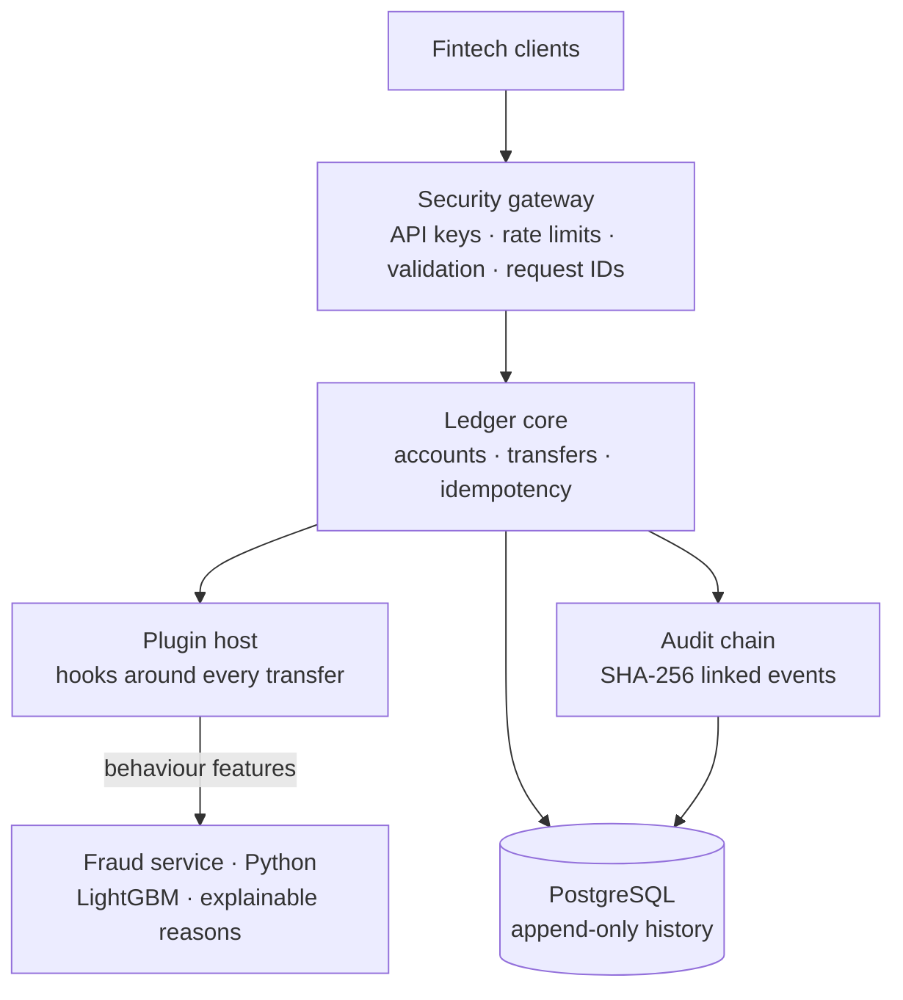

# LedgerForge

[](https://github.com/Moreitu1985/Fintech-sandbox-API-/actions/workflows/ci.yml)


[](LICENSE)

**A secure, multi-tenant double-entry ledger API for fintechs: money that can't be lost, duplicated or quietly rewritten.**

Built with Java 21 and Spring Boot 3, backed by PostgreSQL, and tested for the failures that cost real money: double charges on retry, race conditions between concurrent payments, cross-tenant data leaks and tampered records.

> Sandbox platform: LedgerForge moves simulated money with production-grade rules. Real money movement is planned through a licensed partner (see Roadmap).

---

## Why it exists

Every fintech needs a ledger, and most build one from scratch. The hard parts, correctness under concurrency, safe retries and trustworthy audit history, take months and are easy to get subtly wrong. LedgerForge packages those parts as a tested API.

## What it does

| Capability | How |
|---|---|
| Double-entry ledger | Every transfer writes two postings that sum to zero; balances are verifiable against history |
| Safe retries | `Idempotency-Key` header: a retried request returns the original result and never moves money twice |
| Concurrency safety | Row locks taken in a fixed order: no lost updates, no deadlocks, no negative customer balances |
| Multi-tenancy | Each fintech sees only its own data; cross-tenant ids return 404 |
| Tamper-evident audit | Per-tenant SHA-256 hash chain; append-only tables enforced by PostgreSQL triggers |
| Proof on demand | `GET /v1/ledger/integrity` checks that books balance, balances match postings and the audit chain is intact |
| Plugins | `TransferPlugin` beans hook into every transfer without touching the core (examples: per-transfer limit, fraud check) |
| AI fraud detection | A Python ML service scores each customer transfer before money moves: **BLOCK**, **REVIEW** or **ALLOW**, with plain-language reasons ([model card](fraud-service/MODEL_CARD.md)) |
| API security | Hashed API keys, constant-time checks, rate limiting, strict headers, RFC 9457 errors with request ids |

## Architecture



## AI fraud detection (Phase 2)

Before a customer transfer moves money, the `fraud-check` plugin computes behaviour features from the ledger itself (amount vs. the account's usual, transfers in the last hour, first payment to this recipient, share of balance used, account age, time of day) and asks the [fraud service](fraud-service/) for a decision.

| Decision | What happens |
|---|---|
| **BLOCK** | Transfer refused with `422 PLUGIN_REJECTED` and the model's reasons; no money moves |
| **REVIEW** | Transfer goes ahead; a `FRAUD_REVIEW` event with score and reasons is added to the tamper-evident audit chain |
| **ALLOW** | Nothing extra |

Example reasons for a blocked transfer: *"Transfer uses 97% of the available balance · First transfer to this recipient · Time of day (02:00) raised the risk"*.

Held-out results on synthetic data: at a 1% false-alarm rate the model catches **95.6%** of fraud, against **25.5%** for a hand-written rule at a similar rate. BLOCK decisions are **96.6%** precise. CI retrains the model and fails if quality drops. See the [model card](fraud-service/MODEL_CARD.md) for data, thresholds and limitations.

Turn it on with `FRAUD_ENABLED=true`, `FRAUD_SERVICE_URL` and `FRAUD_SERVICE_TOKEN`. `docker compose up` runs all three services together. If the fraud service is down, `FRAUD_FAIL_OPEN` decides whether transfers continue (logged) or are refused with `503`.

## Public demo

[](https://render.com/deploy?repo=https://github.com/Moreitu1985/Fintech-sandbox-API-)

The `demo` profile runs the full API with an in-memory database (it resets on restart), Swagger UI, and self-serve sign-up, so anyone can try it without an admin token:

```bash
# Get your own isolated sandbox tenant and API key
curl -s -X POST https://<demo-host>/sandbox/signup \
  -H "Content-Type: application/json" -d '{"name":"My Test Fintech"}'
```

Then open `https://<demo-host>/swagger-ui.html`, click **Authorize**, paste the key, and try the endpoints. On the free plan the demo sleeps when idle, so the first request can take about a minute.

## Quickstart (5 minutes)

**Run locally (in-memory H2 database).** Needs only Java 21: the Maven Wrapper downloads Maven on first use.

```bash
export LEDGERFORGE_ADMIN_TOKEN=$(openssl rand -hex 32)
./mvnw spring-boot:run      # Windows: .\mvnw.cmd spring-boot:run
```

**Or with PostgreSQL via Docker:**

```bash
cp .env.example .env    # then set real secrets in .env
docker compose up --build
```

**Make your first transfer:**

```bash
# 1. Create a tenant (returns an API key once — store it)
curl -s -X POST localhost:8080/admin/tenants \
  -H "X-Admin-Token: $LEDGERFORGE_ADMIN_TOKEN" -H "Content-Type: application/json" \
  -d '{"name":"Acme Pay"}'
export KEY=lf_test_...   # from the response

# 2. Open a funding account and a customer account
curl -s -X POST localhost:8080/v1/accounts -H "Authorization: Bearer $KEY" \
  -H "Content-Type: application/json" -d '{"name":"Treasury","currency":"ZAR","allowNegative":true}'
curl -s -X POST localhost:8080/v1/accounts -H "Authorization: Bearer $KEY" \
  -H "Content-Type: application/json" -d '{"name":"Thandi","currency":"ZAR"}'

# 3. Move R100.00 (amounts are in cents). Run it twice: the money moves once.
curl -s -X POST localhost:8080/v1/transfers -H "Authorization: Bearer $KEY" \
  -H "Idempotency-Key: first-transfer-001" -H "Content-Type: application/json" \
  -d '{"fromAccountId":"<treasury-id>","toAccountId":"<thandi-id>","amount":10000,"currency":"ZAR"}'

# 4. Prove the books are healthy
curl -s localhost:8080/v1/ledger/integrity -H "Authorization: Bearer $KEY"
```

Interactive API docs (dev profile): <http://localhost:8080/swagger-ui.html>

## API overview

| Method | Path | Purpose |
|---|---|---|
| POST | `/admin/tenants` | Create a tenant and its first API key (admin) |
| POST | `/admin/tenants/{id}/api-keys` | Issue a new key for rotation (admin) |
| DELETE | `/admin/api-keys/{id}` | Revoke a key immediately (admin) |
| POST | `/v1/accounts` | Open an account |
| GET | `/v1/accounts` · `/v1/accounts/{id}` | List accounts · get balance |
| GET | `/v1/accounts/{id}/entries` | Statement, newest first |
| POST | `/v1/transfers` | Transfer (requires `Idempotency-Key`) |
| GET | `/v1/transfers/{id}` | Get a transfer |
| GET | `/v1/ledger/integrity` | Balance and audit-chain proof |
| GET | `/v1/plugins` | Active plugins |

## Tests that prove the guarantees

```bash
./mvnw verify               # Windows: .\mvnw.cmd verify
```

| Test | What it proves |
|---|---|
| `ConcurrencyTest` | 200 parallel random transfers: total money conserved, no negative balances, integrity healthy |
| `IdempotencyTest` | Retries move money once; reusing a key with a different body is rejected |
| `TenantIsolationTest` | A tenant cannot read, list or move another tenant's money |
| `AuditTamperTest` | Editing a past audit record, or deleting the newest ones, directly in the database is detected at the exact index |
| `SecurityTest` | Missing, malformed, forged and revoked keys are rejected; admin is separated; headers are set |
| `FraudCheckPluginTest`, `FraudCheckFailClosedTest` | Features sent to the model are computed correctly; BLOCK moves no money; REVIEW is audited; outages fail open or closed as configured |
| `fraud-service/tests` (pytest) | Scoring API, auth, validation, and model quality gates that fail CI if a retrained model gets worse |
| `TransferFlowTest` | Insufficient funds, currency mismatch, plugin limits and validation errors behave correctly |

## Design decisions

Short records of each trade-off live in [`docs/adr`](docs/adr):

1. [Double-entry ledger with integer minor units](docs/adr/0001-double-entry-ledger.md)
2. [Pessimistic locking in a fixed order](docs/adr/0002-pessimistic-locking.md)
3. [Hashed, prefixed API keys](docs/adr/0003-api-key-hashing.md)
4. [Hash-chained audit log](docs/adr/0004-hash-chained-audit.md)
5. [Fraud scoring as a synchronous plugin](docs/adr/0005-fraud-scoring-plugin.md)

Security analysis: [`docs/THREAT_MODEL.md`](docs/THREAT_MODEL.md).

## Roadmap

| Phase | Focus | Status |
|---|---|---|
| 1 | Ledger core, security, tests, Docker, CI, public demo profile | Done |
| 2 | Python fraud-scoring service as a transfer plugin (done); LLM assistant endpoint | In progress |
| 3 | OAuth2 + mTLS, Redis rate limits, OpenTelemetry, Testcontainers, Kubernetes, load tests | Planned |
| 4 | Next.js developer dashboard, TypeScript SDK, webhooks | Planned |
| 5 | Licensed-partner connectors (bank, KYC, open banking), POPIA review, SOC 2 readiness | Planned |

## Tech stack

**Ledger:** Java 21 · Spring Boot 3.5 · Spring Security · Spring Data JPA / Hibernate · PostgreSQL · Flyway · H2 (tests) · springdoc OpenAPI · JUnit 5

**Fraud service:** Python 3.13 · FastAPI · LightGBM (TreeSHAP explanations) · scikit-learn · pandas · pytest

**Delivery and security:** Docker · Docker Compose · GitHub Actions · CodeQL (Java + Python) · Trivy · Dependabot · Render

## License

MIT. See [LICENSE](LICENSE).
