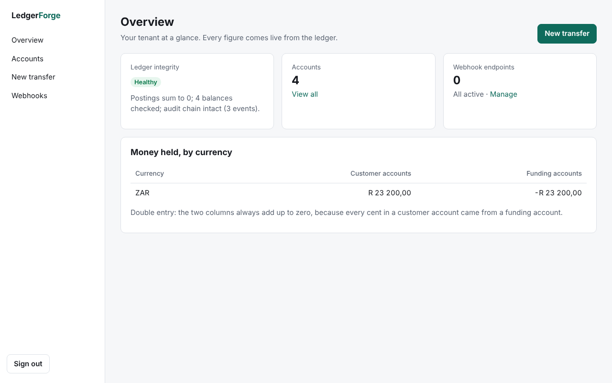

# LedgerForge developer dashboard

A Next.js 16 app where a fintech signs in with its API key and works with its own ledger:

- **Overview:** ledger integrity (balanced postings, intact audit chain), accounts, money held by currency, webhook health
- **Accounts:** list, open, and per-account statements
- **Transfers:** a form that can't pay twice (see below) and transfer details
- **Webhooks:** register endpoints (the signing secret is shown once), delivery history, test events, secret rotation, re-enable, retry and delete



## How it keeps the API key safe

The browser never holds the API key. The dashboard is a *backend for frontend*: every page is rendered on the server, which calls the API with the [TypeScript SDK](../sdk/typescript).

- **Sign-in checks the key.** It calls the API once with the key, then stores the key in a cookie encrypted and authenticated with AES-256-GCM (`DASHBOARD_SESSION_SECRET`).
- **The cookie is locked down.** It is `HttpOnly` (scripts can't read it), `SameSite=Strict` (other sites can't make the browser send it) and `Secure` in production, and it expires after 8 hours.
- **The key never reaches a page.** Only the data the pages show is sent to the browser, and the end-to-end test checks the key appears in none of them.
- **A revoked key ends the session.** If the API rejects the key, the session is cleared and you're asked to sign in again.
- **Strict security headers.** A Content-Security-Policy with a fresh nonce per request (`proxy.ts`) allows only the dashboard's own scripts, so injected inline script can't run. Framing is blocked, there's no `Referer`, pages are `no-store`, and HSTS is on in production. Banners after an action come from a fixed list, so a link can't put its own text in a trusted-looking message.
- **Malformed input stops at the dashboard.** Ids that aren't UUIDs and odd page numbers are rejected there, before any API call.
- **Protected form actions.** They are Next.js server actions: same-origin checked, and each one re-reads the session.

Use a separate API key for the dashboard so it can be revoked on its own.

### Transfers that can't happen twice

When the transfer form loads, the server gives it a fresh idempotency key. A double click, or resubmitting after a network error, sends the same key, so the API returns the original transfer (the page says so) instead of moving the money again.

- **After a definite result,** the form takes a new key. A definite result is a transfer that posted (or replayed), or one the API says already used this key with different details.
- **After a failure,** such as insufficient funds or the API being unreachable, the form keeps its key and the typed values, so resubmitting is the same payment.
- **If the page is re-rendered mid-submit,** the form carries on with the unsettled key, which is kept in `sessionStorage` for the tab.

Amounts are parsed exactly (`"0.1"` becomes `10` cents, never `9.999...`), in the currency's own precision.

## Run it

```bash
# 1. The SDK it uses
cd sdk/typescript && npm ci && npm run build && cd ../..
# 2. The dashboard (development, with a running API on :8080)
cd dashboard && npm ci && LEDGERFORGE_API_URL=http://localhost:8080 npm run dev
```

Or everything at once with Docker: `docker compose up` (set `DASHBOARD_SESSION_SECRET` in `.env`), then open http://localhost:3000.

| Setting | |
|---|---|
| `LEDGERFORGE_API_URL` | The API, from the dashboard server's point of view (default `http://localhost:8080`) |
| `DASHBOARD_SESSION_SECRET` | Base64 for 32 random bytes (`openssl rand -base64 32`). Required in production; in development a temporary one is generated |

Production cookies are `Secure`: serve the dashboard over HTTPS (browsers make an exception for `http://localhost`).

## Tests

```bash
npm test                 # session encryption and amount parsing (node:test)
npm run build
LEDGERFORGE_API_URL=http://localhost:8080 ADMIN_TOKEN=... npx playwright test
```

The Playwright suite runs in CI against the real API (`.github/workflows/dashboard.yml`). It covers:
- sign-in and refused keys
- that pages need a session
- the security headers and cookie flags
- opening accounts and making transfers: a double click must not pay twice, two transfers can be made from one page load, and a resubmit after a lost response must be recognised as the same payment
- the API's insufficient-funds error
- that the key never appears in any page
- registering a webhook and seeing its secret only once, then sending a test event and verifying its signature with the SDK
- sign-out, and a revoked key ending the session (with a relative redirect that other sites can't trigger)
- bad ids returning 404, and links being unable to write banners

The screenshots above use demo data.
